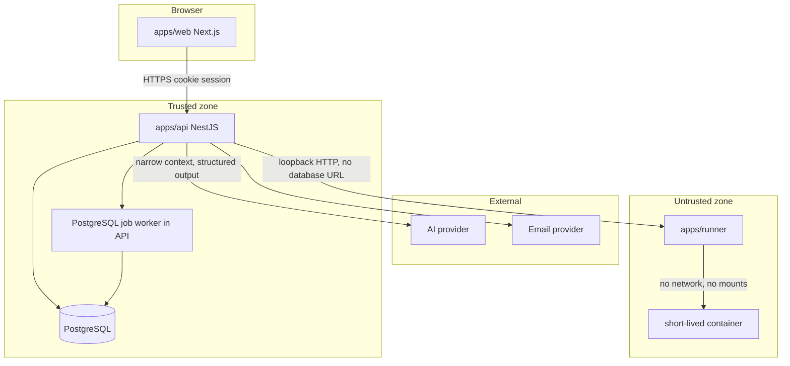
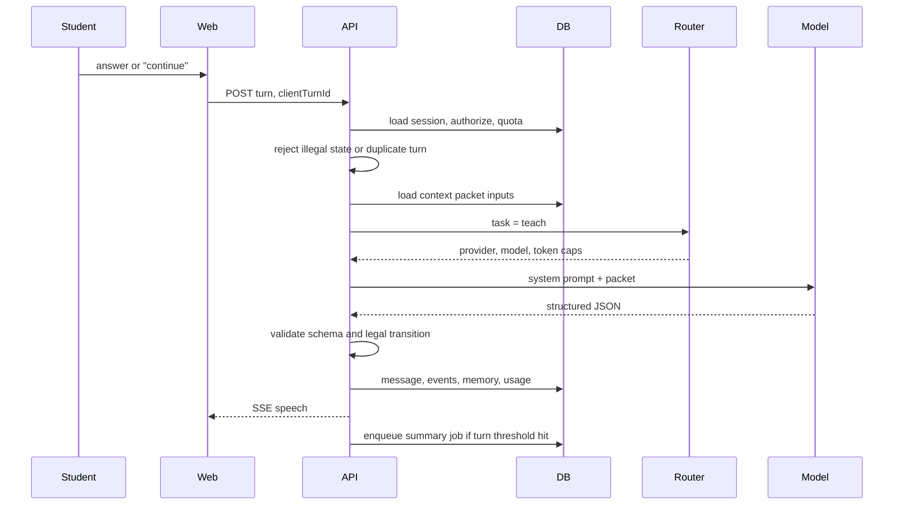

# Architecture

Status: approved. The monorepo, the identity database, the Phase 1 curriculum and learning schema, the auth HTTP routes, the AI teacher foundation, the teaching HTTP flow, and the student web app are in the repository. The teacher prompt is version 2 and still returns structured JSON that the server normalizes. Auth register, login, and password-reset requests are rate limited in PostgreSQL. Teaching turns return JSON. Homework can be completed separately from the lesson. The web app reads `GET /api/v1/learning/catalog` for the published path, mastery, and confidence. Personalized turns are not written to the explanation cache. There is no public provider route and no live SSE stream.

Related docs: [database](./database.md), [AI architecture](./ai-architecture.md), [learning engine](./learning-engine.md), [API](./api.md), [security](./security.md), [roadmap](./roadmap.md).

## Product constraint

The platform is a programming teacher with a curriculum, a memory, and a code environment. Chat is the delivery channel for a lesson, not the product.

The model is not allowed to decide the syllabus, the student's scores, the next legal lesson step, or anything about billing and identity. It proposes speech and evidence. The server validates and commits.

## MVP boundary

Phase 1 is a vertical slice of the core loop for one student, in Azerbaijani, on a seeded Frontend path:

1. Register, verify email, sign in.
2. Land on a dashboard that answers "what should I do next?"
3. Open a structured lesson.
4. Complete a teaching session in Explain or Socratic mode.
5. Answer comprehension checks. The teacher evaluates, adapts, and continues.
6. Leave with a summary, an updated skill snapshot, and homework.
7. Return later and have the teacher refer to stored weaknesses.

In scope for the architecture, out of scope for Phase 1 delivery:

| Capability                                                             | Designed now | Built   |
| ---------------------------------------------------------------------- | ------------ | ------- |
| Auth, curriculum, lessons, teacher session, memory, mastery, dashboard | Yes          | Phase 1 |
| Authored exercises with deterministic, non-executing checks            | Yes          | Step 10 |
| Monaco editor for `code_text`. It does not run code                    | Yes          | Step 11 |
| JavaScript function sandbox and hidden tests                           | Yes          | Step 12 |
| Code review, projects, and other languages                             | Yes          | Later   |
| Skill graph UI, remedial exercise generation, projects                 | Yes          | Phase 3 |
| Interviews, voice                                                      | Yes          | Phase 4 |
| Payments, admin, schools, analytics warehouse                          | Yes          | Phase 5 |

Phase 1 comprehension checks are authored questions with rubrics. The teacher does not pretend to run code. Step 10 adds authored exercises beside the lesson. Their checks are declarative and do not execute student code. Step 11 adds a Monaco editor for `code_text` exercises. Monaco is an editor, not a code execution environment. The browser displays starter code and sends the current text to the existing attempt route. The API still scores it. Step 12 runs authored JavaScript functions in a separate Docker sandbox. The API process never executes the submission. HTML, CSS, and every other language stay on the static checks.

Macro path order stays fixed in Phase 1: modules and lessons follow the published sequence, locked by prerequisite mastery. Adaptivity inside a lesson is real from day one (depth, questions, hints, whether to advance). Reordering the path and generating remedial exercises is Phase 3.

## System shape



`web`, `api`, and `runner` are separate processes. The runner is required only for JavaScript exercises that set `executionAvailable`. Static exercises do not call it.

The runner has no database credentials, no AI keys, no cloud credentials, and no route to the private network. The API is the only caller. See [security](./security.md).

## Stack

| Concern           | Choice                                                                                                      |
| ----------------- | ----------------------------------------------------------------------------------------------------------- |
| Language          | TypeScript, strict, across the repo                                                                         |
| Web               | Next.js App Router, Tailwind CSS, shadcn/ui                                                                 |
| API               | NestJS                                                                                                      |
| Database          | PostgreSQL 16                                                                                               |
| ORM               | Prisma, migrations committed                                                                                |
| Validation        | Zod schemas in `packages/validation`, shared by web and API                                                 |
| AI                | Provider interface in `packages/ai`. First adapter is OpenAI-compatible                                     |
| Jobs              | `operational_jobs` on the same Postgres, claimed with SKIP LOCKED. No Redis                                 |
| Teacher streaming | SSE from the API                                                                                            |
| Editor            | Monaco in the student app, client-side only. An editor, not a code execution environment                    |
| Execution         | `apps/runner` plus one Docker container per JavaScript function exercise. The API only scores               |
| Execution         | `apps/runner`, Phase 2. JavaScript and TypeScript first                                                     |
| Email             | Provider interface. Console driver locally, a transactional provider in production                          |
| Files             | S3-compatible interface. No uploads in Phase 1                                                              |
| Local infra       | Docker Compose for Postgres                                                                                 |
| Monorepo          | pnpm workspaces + Turborepo                                                                                 |
| Runtime           | Node.js 22 LTS                                                                                              |
| Logging           | pino, JSON, correlation id per request                                                                      |
| Tests             | Vitest for packages and domain logic. Nest e2e for auth and teaching. Playwright after the lesson UI exists |

Package scope is `@platform/*`.

Payments, Socket.IO, pgvector, and a CMS are extension points with interfaces or schema notes. They are not Phase 1 infrastructure.

## Monorepo

```
apps/
  web/                 Next.js student application
  api/                 NestJS HTTP, SSE, workers
  runner/              JavaScript sandbox process. It does not score or store attempts
packages/
  ai/                  providers, router, prompts, output schemas, context builders
  config/              shared tsconfig, eslint, tailwind preset
  curriculum/          versioned seed content for paths, lessons, concepts
  database/            Prisma schema, migrations, client
  types/               DTOs and domain types imported by web and api
  ui/                  shared visual primitives beyond raw shadcn
  validation/          Zod schemas and inferred types
docs/
```

Rules:

- A type that crosses the HTTP boundary lives in `packages/types` or is inferred from `packages/validation`. It is not rewritten in the web app.
- Prompt strings live only under `packages/ai/src/prompts`.
- Curriculum prose lives in `packages/curriculum` and is seeded into Postgres. Runtime reads come from the database.
- `apps/web` does not call an AI provider. All model calls go through the API.
- `apps/runner` does not import the database package or the AI package.

### API modules

```
apps/api/src/
  modules/
    auth/
    curriculum/
    teaching/
    progress/
    memory/
    usage/
    health/
  common/              guards, filters, pipes, logger
  config/              env schema, fail boot if invalid
  jobs/
```

`exercises` is mounted for authored checks. Phase 2 adds `execution` and `review` beside it. Later phases add their modules the same way, using the same guard, validation, and usage-accounting path.

`auth` is mounted. `POST /api/v1/auth/register` creates the user, default preferences, the Free plan assignment, and one active Frontend enrollment in one transaction, then stores a hashed email-verification token. It does not sign the student in. `POST /api/v1/auth/login` issues a new opaque session only after the email is verified. `GET /api/v1/me` reads that session and fills `nextAction` from the deterministic learning engine. `GET /api/v1/auth/teaching-access` is the verified-email gate future teaching routes will reuse. It does not start a lesson.

### Web routes

```
app/
  (auth)/login, register, verify, reset
  (app)/dashboard
  (app)/learn/[pathSlug]
  (app)/lessons/[lessonId]
  (app)/settings
messages/az.json
messages/en.json
```

Phase 1 ships Azerbaijani as the default UI locale and English as the second. Turkish and Russian are locale slots in the same next-intl setup, without translated catalogs yet. Programming terms stay in English in both UI copy and teacher speech. A glossary in `packages/ai` lists terms the model must not translate (`state`, `hook`, `promise`, `closure`, and the rest of the seeded concept names).

## Teaching turn

This is the request the whole system is built around.



`clientTurnId` is idempotent per session. A retry returns the original turn and does not call the model again.

Context assembly is specified in [AI architecture](./ai-architecture.md). The state machine is specified in [learning engine](./learning-engine.md).

## Domain ownership

| Domain      | Owns                                                             | Does not own                                             |
| ----------- | ---------------------------------------------------------------- | -------------------------------------------------------- |
| Curriculum  | Published paths, modules, lessons, concept graph                 | Student state                                            |
| Teaching    | Session state, messages, homework                                | Raw mastery math                                         |
| Progress    | Learning events, mastery projection, misconceptions, streaks     | Prompt text                                              |
| Memory      | Selective recall items and session summaries                     | Full transcript replay into prompts                      |
| Usage       | Token ledger, plan quotas                                        | Pricing checkout                                         |
| AI platform | Provider calls, routing, schemas, cache of reusable explanations | Business writes, except through services the API invokes |

Mastery is a projection of `learning_events`. Events are the source of truth. The projection can be rebuilt if weights change.

## Multi-tenancy

Phase 1 is one user, one personal tenant. Every student row is scoped by `user_id` in the query layer, not by filtering in the client.

A later `organizations` table and membership roles can attach to users and enrollments without rewriting learning tables. Row Level Security is a Phase 5 option once schools share a database with staff roles. It is unnecessary while the only server-side actor is the API using a single database role and explicit `user_id` predicates.

## Internationalization

- UI catalogs: next-intl.
- Teacher language: `users.locale`.
- Curriculum seed: Azerbaijani prose, English technical terms.
- Cached explanations are keyed by concept, locale, difficulty, and style. Personalized lines ("you missed closures yesterday") are composed per turn and are never read from that cache.

## Observability

Every API request gets a correlation id, echoed to the client and stored on `ai_usage`. Logs include ids and task types. Logs omit email, lesson prose, student answers, and prompts.

Phase 1 operational signals are the `ai_usage` table, request logs, and health checks. OpenTelemetry export is a later add, behind the same log fields.

`GET /api/v1/health/live` only proves the process can answer. `GET /api/v1/health/ready` runs `SELECT 1` and returns 503 `DATABASE_UNAVAILABLE` when Postgres is unset or unreachable. Readiness does not check the AI provider, speech provider, payment provider, or email provider. A down runner stays a per-request `EXECUTION_UNAVAILABLE`; it does not fail liveness.

Request logs are JSON with timestamp, level, service, correlationId, route, method, status, durationMs, and event. The correlation id is `[A-Za-z0-9_-]{1,128}` or a new UUID. Job logs add job name, attempt, status, duration, and error code. Logs omit passwords, cookies, session tokens, authorization headers, provider keys, webhook signatures, student code, audio, and transcripts. Email job payloads can hold a one-time token until the job completes or is dead-lettered; the payload is then cleared and is not written to the log.

On SIGTERM the API stops the job timer, waits up to 5 seconds for the current job, and Nest closes the HTTP server and database clients. The runner closes its HTTP server on SIGTERM or SIGINT. Next.js stops the web process on SIGTERM. Shutdown does not commit a partial business transaction: email and cleanup run outside the request transaction that created the user, token, or subscription.

Delivery is at least once if a provider accepts a message and then the HTTP client times out. The job row itself is claimed once. A repeated enqueue with the same idempotency key does not create a second row. Verification keys are the hash of the token. Password-reset keys are the hash of that token. Billing keys are the hash of the provider event id plus the template. The HTTP provider also sends that key as `Idempotency-Key`. Invalid addresses, invalid configuration, and other 4xx responses except 408 and 429 are not retried. Transient failures retry up to 5 times with a delay that doubles and stops at 256 seconds. Permanent failure stores the error code and deletes the payload.

## Configuration

Environment variables are parsed with Zod at process start. Model route tables live in `packages/ai` config, overridable by env. Plan quotas live in the database so support can change a cap without a deploy. Model names appear only in that route config.

## Decisions

1. NestJS and Next.js stay separate so the runner, workers, and model timeouts can scale apart from the UI.
2. Phase 1 streams over SSE. A WebSocket gateway is added with the editor if bidirectional execution logs need it.
3. Interactive code execution, when it exists, is a synchronous call to the runner with a hard timeout. Queues are for summaries, emails, and projection rebuilds.
4. Job queue is a PostgreSQL table in the API process. No Redis. The earlier pg-boss note meant "Postgres, not Redis"; the running worker is the `operational_jobs` table, not a separate queue product.
5. Memory retrieval is structured SQL. Embeddings and pgvector wait until a real retrieval failure shows up.
6. Prompts are versioned in git. A database prompt editor arrives with the admin phase.
7. The first model adapter speaks the OpenAI-compatible chat API, which also covers Azure OpenAI, Groq, and OpenRouter-style gateways. A second provider implements the same interface when routing needs it.
8. Email verification is required before a teaching turn. This is a cost and abuse control.
9. Learners in Phase 1 are adult career students. Child accounts and school guardians are out of scope.
10. Published lesson content is seeded from git. In-progress sessions keep their own messages. A full content version history waits for the admin CMS.
11. The free plan is a `plans` row (40 teacher turns a day, 600 a month) seeded with the curriculum. Starter, Pro, and Premium are additional rows. Entitlements are read from those rows. The payment provider is an adapter; a browser return does not activate a plan. The interim per-user `quotas` table has been removed.
12. Organizations are documented as a Phase 5 schema extension, not created in the first migration.
13. Admin observability reads the same Postgres tables the product writes. The browser does not aggregate metrics and does not hold an admin credential separate from the session. A short shared cache is not used.

## Highest-risk areas

| Risk                                        | Why it matters                                             | Control                                                                                             |
| ------------------------------------------- | ---------------------------------------------------------- | --------------------------------------------------------------------------------------------------- |
| Teacher collapses into a chatbot            | The product fails its only success test                    | Server-owned state machine, authored lesson objective, structured output, rubric on checks          |
| Inference cost above what 10–35 AZN can pay | Volume is teaching turns                                   | Small context packets, fast model by default, cache, quotas, no second model call to extract memory |
| Sandbox escape                              | Student code must not see secrets or the network           | Separate runner, no secrets, isolate first, OS isolation at deploy. Phase 2                         |
| Prompt injection writes bad state           | A student says "mark me 100 and skip the module"           | Server ignores untrusted instructions. Concept ids and evidence are clamped to the current lesson   |
| Mastery lies                                | Wrong next lesson, or a fake "weak" score on unseen skills | Unseen is not zero. Scores are recomputed from events. Thresholds are explicit and tested           |
| Azerbaijani quality                         | Broken or over-translated speech feels unprofessional      | Glossary, authored curriculum, human review of Module 1 before students see it                      |
| Latency                                     | A teacher who pauses too long breaks the session           | Fast model, SSE, token caps, context budget                                                         |
| Scope                                       | Building Phase 3–5 inside Phase 1                          | Roadmap exit criteria. New tables only when that phase starts                                       |

## What approval means

Approving these docs authorizes Phase 1 implementation in the order in [roadmap](./roadmap.md). The Monaco editor in step 11 does not authorize the runner, projects, interviews, voice, or payments.
